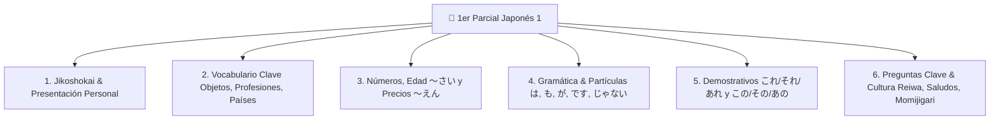

# Plan de Implementación: Pestaña "Práctica 1er Parcial" (Japonés 1 - Universidad Javeriana)

Este plan detalla la creación de un nuevo módulo integral de estudio y simulación para el **1er Parcial de Japonés 1 (Prof. Yeny • Pontificia Universidad Javeriana)**, incorporando todo el contenido de la infografía y las hojas de examen compartidas por el estudiante.

---

## 🎯 Alcance del Módulo del Parcial

A partir del análisis de las 5 imágenes del examen, el parcial evalúa 6 bloques temáticos fundamentales:



El nuevo módulo se ubicará en la barra de navegación principal como una nueva pestaña destacada: **`🎯 1er Parcial`** (botón `#nav-parcial`, contenedor `#tab-parcial`), situada estratégicamente junto a la pestaña de Números.

---

## 🛠️ Herramientas y Sub-Modos de Estudio Incluidos

Dentro de la pestaña del Parcial, el estudiante podrá alternar libremente entre **4 herramientas pedagógicas**:

### 1. 📋 Resumen Interactivo del Parcial (Ficha de Estudio)
Una versión interactiva, visual y con audio del afiche oficial del parcial:
- **Jikoshokai (Presentación):** Plantilla interactiva con audio para armar `わたし は [Nombre] です。` y `わたし の なまえ は [Nombre] です。`
- **Vocabulario Clave (30+ palabras con audio nativo):**
  - *Objetos:* `ほん` (libro), `みず` (agua), `えんぴつ` (lápiz), `かさ` (paraguas), `けいたい` (celular), `かばん` (mochila), `おべんとう` (almuerzo), `おにぎり` (onigiri), `でんわ` (teléfono), `まんが` (manga), `ふでばこ` (estuche), `じしょ` (diccionario), `めがね` (gafas), `おちゃ` (té).
  - *Personas y Profesiones:* `せんせい` (profesor), `がくせい` (estudiante), `おとうさん` (papá), `おかあさん` (mamá), `おにいさん` (hermano mayor), `いもうと` (hermana menor), `ともだち` (amigo), `いしゃ` (médico), `かいしゃいん` (empleado), `しゅふ` (ama de casa), `エンジニア` (ingeniero).
  - *Países e Idiomas:* `にほん / にほんご / にほんじん`, `ちゅうごく / ちゅうごくご / ちゅうごくじん`, `かんこく / かんこくご / かんこくじん`, `ロシア / ロシアご`, `タイ / タイご`.
- **Gramática y Demostrativos:**
  - Tablas visuales explicativas de `これ / それ / あれ` (demostrativos solos) vs `この / その / あの + Sustantivo`.
  - Partículas fundamentales: `は` (tema), `も` (también), `が` (capacidad con *dekimasu*), `の` (posesión/pertenencia).
  - Afirmativo (`です`), negativo (`じゃありません / じゃないです`), interrogativo (`ですか`).
  - Habilidad: `[Idioma] が できます` (sé / puedo), `すこし できます` (sé un poco), `できません` (no sé / no puedo).
- **Preguntas básicas:** `なに ですか？`, `なんさい ですか？`, `いくら ですか？`, `だれ の ですか？`
- **Cultura Japonesa (Datos fijos de examen):**
  - Era actual: **Reiwa 令和** (desde 2019).
  - Al salir de casa: `いってきます` (quien sale) $\leftrightarrow$ `いってらっしゃい` (quien se queda).
  - Al volver a casa: `ただいま` (quien llega) $\leftrightarrow$ `おかえりなさい` (quien recibe).
  - `もみじ狩り (Momijigari)`: Tradición de contemplar las hojas de arce en otoño.

---

### 2. 📝 Simulador Tipo Parcial (Ejercicios Idénticos a las Hojas de Examen)
Tres dinámicas calcadas del modelo de evaluación mostrado en las imágenes:

- **Formato Q1: Selección múltiple de partículas y palabras:**
  - Ej: `おしごと [ は ] なんですか。`
  - Ej: `あいさんは にほんごが できます。えいご [ も ] できます。`
  - Ej: `ワンさんは せんせいですか。` $\rightarrow$ `いいえ、[ せんせいじゃありません ]。`
  - Ej: `タイごが できますか。` $\rightarrow$ `はい、すこし [ できます ]。`
- **Formato Q2: Ordenar la Oración (Scramble con fichas interactivas):**
  - El estudiante hace clic en fichas desordenadas para formar la frase correcta:
    - `[ えいご ][ できます ][ が ][ わたし ][ は ]` $\rightarrow$ `わたし は えいご が できます。`
    - `[ なん ][ か ][ おしごと ][ は ][ です ]` $\rightarrow$ `おしごと は なん です か。`
    - `[ せんせい ][ です ][ シンさん ][ も ]` $\rightarrow$ `シンさん も せんせい です。`
    - `[ これ ][ ほん ][ は ][ だれ ][ の ][ です ][ か ]` $\rightarrow$ `これ は だれ の ほん です か。`
- **Formato Q3: Comprensión Auditiva y Situacional (Listening):**
  - Audio con la pregunta en japonés (`どこから きましたか`, `おしごとは なんですか`, `いくらですか`).
  - Imagen/icono contextual y dos opciones de respuesta para evaluar si entendió la distinción (ej: país vs idioma, profesión, etc.).

---

### 3. 💴 Taller de Precios, Edades y Números (えん / さい / すうじ)
Práctica especializada en las preguntas cuantitativas del examen:
- **Precios (`いくら ですか？` $\rightarrow$ `[Número] えん です`):**
  - Escuchar precios en yenes (hasta 999¥, con las 3 mutaciones fonéticas `300`, `600`, `800`) y escribir el valor numérico o seleccionar la respuesta.
  - Ejemplos del afiche: `500えん` (*gohyaku en*), `750えん`, `999えん` (*kyuuhyaku kyuujuu kyuu en*).
- **Edades (`なんさい ですか？` $\rightarrow$ `[Número] さい です`):**
  - Formación regular `[Dígito] + さい`.
  - Excepción del examen: `20さい` $\rightarrow$ `はたち` (*hatachi*) o `にじゅっさい`.

---

### 4. 🎴 Flashcards de Vocabulario Rápido (Flip Cards con Audio)
- Tarjetas con las 30 palabras clave organizadas por categoría (Objetos, Profesiones, Países, Saludos, Cultura).
- Muestra el dibujo/icono y el hiragana.
- Al voltear, muestra Romaji, significado en español y botón de audio para memorizar antes de entrar al simulador.

---

## 💻 Cambios Técnicos en el Código

### [MODIFY] [juego japones.html](file:///c:/Users/tmax3/OneDrive/Documentos/japones/juego%20japones.html)

1. **Barra de Navegación Principal (`#mainNavbar`):**
   - Agregar el botón `#nav-parcial`:
     ```html
     <button type="button" onclick="switchTabAndCloseDrawer('parcial')" id="nav-parcial" ...>
         <i class="fa-solid fa-graduation-cap text-amber-400"></i>
         <span>1er Parcial</span>
     </button>
     ```
2. **Estructura del Contenedor de la Pestaña (`#tab-parcial`):**
   - Cabecera con título del parcial ("Japonés 1 • 1er Parcial Javeriana").
   - Barra de herramientas interna (Sub-pestañas: `📚 Guía de Estudio`, `📝 Simulador Examen`, `💴 Precios y Edades`, `🎴 Flashcards`).
   - Contenedor dinámico de ejercicios `#parcialWorkspaceContainer`.
3. **Dataset de Preguntas y Contenido (`EXAM_PARCIAL_DATA`):**
   - Preguntas de completar partículas (`は, も, が, の, です, じゃない`).
   - Oraciones desordenadas para el constructor tipo Q2.
   - Situaciones auditivas tipo Q3.
   - Vocabulario y notas culturales (Reiwa, Ittekimasu, Tadaima, Momijigari).
4. **Lógica de Evaluación y Feedback:**
   - Contador de aciertos, temporizador opcional y explicaciones gramaticales inmediatas ante fallos.
   - Atajos de teclado en PC para responder rápidamente (teclas `1..4` y `Enter`).

---

## 🧪 Plan de Verificación

1. **Prueba de Sintaxis:**
   - Ejecutar `node scratch/verify_html_syntax.js` para certificar que el archivo compila con 0 errores de sintaxis.
2. **Prueba de Integración y Navegación:**
   - Validar que `switchTabAndCloseDrawer('parcial')` conmuta correctamente a la pestaña `#tab-parcial`.
   - Validar que los 4 sub-modos (Guía, Simulador Q1/Q2/Q3, Precios/Edades, Flashcards) cambian fluidamente.
3. **Prueba de Verificación de Contenido del Examen:**
   - Corroborar que las 30+ palabras clave, demostrativos (`これ/それ/あれ`, `この/その/あの`), preguntas (`なに`, `なんさい`, `いくら`, `だれ の`), partículas (`は`, `も`, `が`), números hasta 999 con precios/edades y datos de cultura japonesa están presentes al 100%.
4. **Regresión:**
   - Ejecutar `node scratch/test_pedagogical_stages.js` y `node scratch/test_stage7_real_words.js` para asegurar que las 9 etapas de kana y el taller de números continúan funcionando perfectamente.

---

## 🙋‍♂️ Confirmación para Proceder
¿Estás de acuerdo con esta propuesta para el centro de entrenamiento del 1er Parcial? Si das el visto bueno, comenzaremos la implementación de inmediato.
